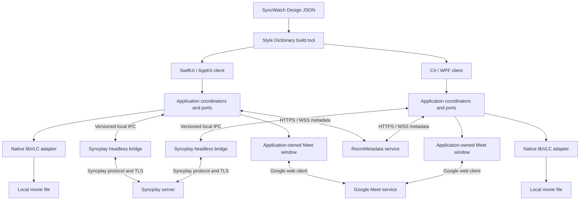
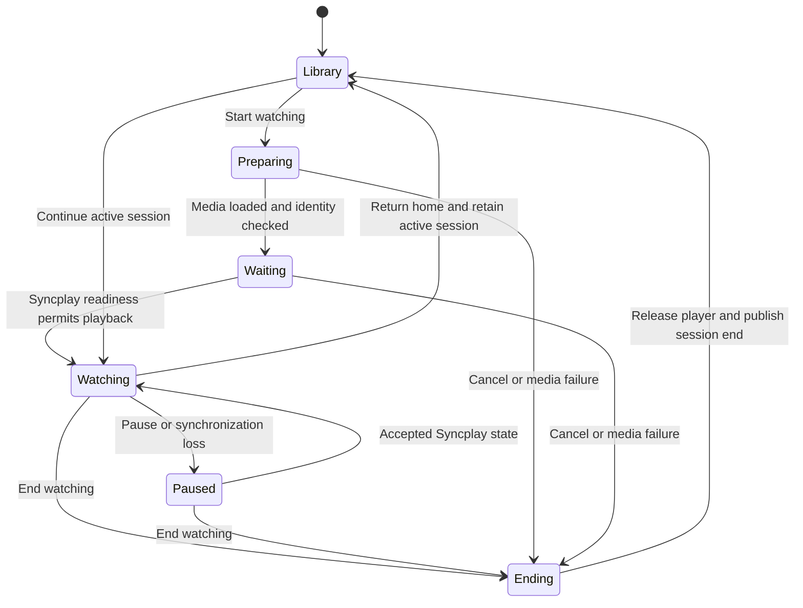

# Application architecture

SyncWatch is a native desktop product for synchronized local movie viewing and video calls. Native Swift/macOS and C#/WPF shells with initial domain ownership guards are implemented. This document specifies the full application architecture; shared-design UI, media, synchronization, and provider integrations remain planned.

## Technology decisions

| Area | Decision |
|---|---|
| Initial platforms | macOS and Windows 11 x64 |
| Apple client | Swift, SwiftUI, and AppKit for video surfaces and window management |
| Windows client | C#, WPF, and .NET 10 LTS, with a small libVLC P/Invoke adapter |
| Shared design | Platform-neutral JSON tokens and component contracts in `packages/design`; Apache 2.0 Style Dictionary generates native resources |
| Playback | Embedded libVLC with SyncWatch controls |
| Synchronization | The upstream Syncplay client engine in a headless helper on each device, connected to a standard Syncplay server |
| Calling | Google Meet in a separate application-owned window, subject to browser-host and capability acceptance |
| Room metadata | A C# / ASP.NET Core service over HTTPS/WSS for catalog and watch-session metadata |
| External libraries | Pinned source submodules under `3rdparty/`, including the complete transitive graph before component builds |
| Continuous integration | GitHub Actions for repository checks, native macOS/Windows builds, reproducible dependencies, integration checks, and trusted release candidates |

The .NET SDK version must be pinned when the Windows project is introduced. See the [.NET support policy](https://dotnet.microsoft.com/en-us/platform/support/policy/dotnet-core). Additional Apple platforms require explicit decisions about process hosting, video surfaces, and call windows; macOS support does not imply iOS or tvOS support.

## Component topology



Each device reads its own movie file. Syncplay exchanges playback state. RoomMetadata exchanges descriptors and watch-session metadata. Google Meet handles calling. Ending a call does not disconnect playback synchronization.

## State ownership

| Module or port | Responsibility and source of truth |
|---|---|
| LibraryService | Local catalog, authorized folder access, filesystem watching, and metadata cache; full paths stay local |
| MediaIdentity | Candidate matching, collision handling, and edition verification |
| WatchSessionCoordinator | Active media, generation, start/continue/end lifecycle, and application navigation |
| PlaybackPort | Media loading, pause, seek, rate, tracks, and local volume; actual VLC state is authoritative for observations |
| SyncPort | Syncplay connection, participant list, readiness, shared playback state, and drift correction |
| RoomPort | Catalog exchange, media selection, session generations, missing media, Meet URI, and cross-channel participant binding |
| PreviewService | Separate bounded preview decoder and cache with cancellation; never changes the main player |
| CallPort | Call window state and verified provider capabilities; page load does not imply call participation |
| SettingsService | Versioned local preferences, theme, language, playback settings, and schema upgrades |
| ConnectionSupervisor | Independent recovery of playback synchronization, metadata, and call channels |
| Design renderer | Displays state and emits user actions; contains no networking or media engine logic |

Swift and C# implement the [shared contracts](contracts.md) and use the same acceptance fixtures. Domain behavior remains independent of UI and provider SDK types. The Python helper adapts the selected Syncplay engine while the application remains native Swift or C#.

## Native video integration

On macOS, pass an AppKit `NSView` to `libvlc_media_player_set_nsobject`. Keep the view alive until rendering stops. Use an AppKit container and native window manager with SwiftUI controls. Validate compositing, clipping, fullscreen transitions, and hardware decoding.

On Windows, pass a native HWND to `libvlc_media_player_set_hwnd`. WPF controls cannot simply overlap another HWND because of airspace restrictions. The planned video host uses an owned overlay window for player controls and popovers, with coordinated position, DPI, focus, minimize, and fullscreen behavior. Validate this before implementing the full player UI. CPU-copy video callbacks require performance measurements before adoption for 4K playback. See [WPF technology regions](https://learn.microsoft.com/en-us/dotnet/desktop/wpf/advanced/technology-regions-overview).

VLC image-adjustment APIs cover part of the image settings. Subtitle typography, external audio, audio normalization, and scaling still need working mappings for the selected module set. Some settings may require media reconfiguration. Every enabled control must have a verified effect. C API headers are in `3rdparty/vlc/include/vlc/`.

## Watch lifecycle



The watch and call lifecycles are separate. Returning home retains the active watch session. End releases it. A new application launch may restore the last position, but it does not reactivate the previous session automatically.

Synchronization loss pauses playback and resets the rate to 1.0. Commands from an old generation are rejected. A call-only failure does not pause the movie. Metadata-only failure retains the agreed media but blocks operations that require a new shared selection.

## Source layout

Native shells, initial domain modules, the design package, documentation, contracts, native/contract/CI tooling, workflows, and pinned submodules exist. Media/provider services and full product workflows in the layout below remain planned:

```text
apps/apple/                 # Swift application and native platform adapters
apps/windows/               # C# WPF application and native platform adapters
packages/design/            # Platform-neutral design data and component contracts
packages/apple-domain/      # Swift domain and use cases, independent of SwiftUI
packages/windows-domain/    # C# domain and use cases, independent of WPF
contracts/                  # JSON schemas and shared acceptance fixtures
services/syncplay-bridge/   # Headless Python entry point and player/UI adapters
services/room-metadata/     # C# ASP.NET Core metadata service
tools/design/              # Custom Style Dictionary formatters
tools/dependencies/        # Source graph and deterministic build tooling
tools/ci/                  # Shared local/CI validation and orchestration
tools/contracts/           # Offline reference contract validation and tests
tools/native/              # Native SDK, formatting, build, and test entry points
.github/workflows/         # Repository, platform, dependency, integration, and release jobs
tests/                      # Planned integration coverage
3rdparty/                   # External source Git submodules
docs/                       # All project documentation
```

Dependencies point from UI to application to domain. Filesystem, VLC, Syncplay, and Meet integrations implement domain-facing ports. The design package does not import application services or domain logic.

## Local data and permissions

Store versioned preferences and caches under Application Support on macOS and LocalAppData on Windows, using atomic writes. Store credentials in Keychain or protected Windows storage. Use an application-specific browser profile. Balance macOS security-scoped access for the lifetime of each media or folder operation.

Shared design assets contain no account, device, or room data. Catalog exchange sends only permitted media descriptors. A missing file does not trigger an upload. Audio controls affect only the intended movie or verified call output; system communications policy and other applications' volume remain outside the product's control.

## Integration gates

| Gate | Acceptance required |
|---|---|
| G1: Google Meet | A usable application-owned call window on both platforms, account access, two-way media, hangup, and an explicit capability result |
| G2: VLC functionality | Windows overlay behavior, previews, tracks, all exposed player settings, and measured movie-plus-call performance |
| G3: Dependency closure | Complete transitive source submodules, reproducible component builds, and correct binary notices |
| G4: Syncplay bridge | Headless initialization, IPC lifecycle, upstream interoperability, and two-device recovery |
| G5: Visual acceptance | Native rendering and interaction checks against the shared design specification |

A failed gate remains an unmet requirement. A change to the call provider, window model, or product capabilities requires an explicit product decision.

## Related specifications

- [Product requirements](product-requirements.md).
- [Native development](../native-development.md).
- [Shared design system](design-system.md).
- [Shared contracts](contracts.md).
- [Syncplay and room metadata](syncplay.md).
- [Google Meet integration](google-meet.md).
- [External dependencies](dependencies.md).
- [Implementation plan](delivery-plan.md).
- [Pull request implementation plan](pull-request-plan.md).
- [Continuous integration](continuous-integration.md).
- [Validation strategy](validation.md).
