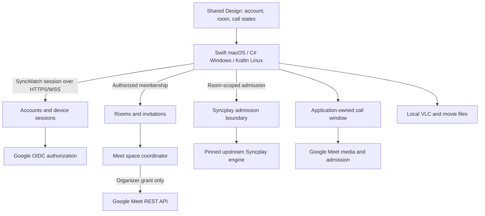

# Google accounts, rooms, and calls

## Decision and implementation boundary

The target experience is one SyncWatch account, one room invitation, and a call associated with that room. Every participant signs in with Google before creating or joining a shared room. First sign-in creates the SyncWatch account automatically; there is no separate password. Local library and local playback remain available without sign-in.

This is a target architecture, not an implemented authentication or calling service. The current [room API](room-service.md) uses creation and membership credentials without Google identity or durable account storage. Its v1 behavior remains unchanged until a versioned replacement is delivered on all three desktops. [Embedded Meet hosting](google-meet.md) remains an unresolved prerequisite: registration and REST authorization do not provide a signed-in Meet surface or a two-way media renderer.

## User journey

1. **Continue with Google.** A supported browser authorization flow returns the result to SyncWatch. Show the selected account before creating the local session. Never collect the Google password in SyncWatch.
2. **Create room.** Create the SyncWatch room immediately. Offer **Start call** in the same flow. Only the organizer grants permission to create Meet spaces, when first needed; declining leaves the room usable for watching.
3. **Invite.** Share one SyncWatch invitation. A recipient signs in, requests admission, and is approved by the owner. A pending request receives no catalog, synchronization access, or meeting URI. An invitation is not an account credential.
4. **Join call.** An admitted participant explicitly opens the room's call, sees a device/permission preview, and joins. Room admission never activates the microphone, camera, or received call audio. A Meet admission or account prompt remains visible when Google requires it.
5. **Watch together.** Syncplay owns playback synchronization and VLC reads each local movie. The call has independent device, output-volume, and connection state.
6. **Leave call**, **Leave room**, and **End room** are distinct. Leaving the call preserves the watch; leaving the room releases that device's call and shared watch; ending the room revokes all room memberships and requests conference termination. Local media and preferences are retained.

The owner is also the initial Meet organizer. Owner departure closes the room, preserving current room semantics. Network interruption gets a bounded reconnect grace; it is not immediate departure. There is no implicit ownership transfer. Any later transfer must distinguish SyncWatch roles from Google organizer/co-host permissions and require a supported provider operation.

## Components and authority

Extend the existing C#/ASP.NET Core service as a modular application with one deployment initially. Avoid a second account database, a separate authentication implementation in each client, or a fleet of microservices. Persistence, identity middleware, cryptography, and browser hosts must have their complete external source graph pinned as Git submodules in `3rdparty/` before adoption. Database engine, driver, migration tooling, and deployment configuration require their own source/license and operational qualification.

| Module | Owns | Must not own |
| --- | --- | --- |
| Accounts | Google identity mapping, account lifecycle, device sessions | Movies, room command ordering, Meet web cookies |
| Rooms | Owner/member roles, invitation approval, room epoch, existing ordered metadata | Playback clock, camera/microphone, Google passwords |
| Meet coordinator | Organizer grant, space identity, provisioning journal, call generation | Browser login, native media rendering, Syncplay timing |
| Sync admission | Server-verified room/run binding, expiring tickets, revocation | A second playback synchronization algorithm |
| Native account adapter | Browser handoff, secure local session storage, cancellation | OAuth client secrets, Google refresh tokens |
| Call host | Qualified participation signals, isolated received audio, capture/window lifetime | Native filesystem access, room/session credentials |
| Shared Design | Common account/room/call components, copy, states, and actions | Network requests, tokens, or authorization decisions |

Backend authorization is authoritative even if a client hides or disables a control. UI, domain, HTTP, persistence, and provider types remain separate. All new UI structure belongs to `packages/design`; native renderers bind the same state/actions without recreating layouts.

## Sign-in and session design

Use a backend-mediated OAuth authorization-code/OIDC flow with a confidential **Web application** client and an exact HTTPS callback on an owned domain. Google credentials stay in the backend. This supports requesting Meet access later through the web authorization flow. Do not assume installed-app incremental authorization: Google's desktop documentation explicitly excludes it. [Web-server OAuth](https://developers.google.com/identity/protocols/oauth2/web-server), [desktop OAuth](https://developers.google.com/identity/protocols/oauth2/native-app).

The desktop starts a short-lived authorization transaction with a cryptographically random, in-memory handoff verifier; the server retains its SHA-256 challenge. It returns an opaque transaction identifier and a browser URL containing no redeemable credential. The browser establishes a secure, HttpOnly authorization cookie and a single-use OAuth `state` before redirecting to Google. The server binds the callback to that browser transaction, checks OIDC `nonce`, validates the result, and requires explicit confirmation of the selected account. The originating desktop redeems the result once over HTTPS using the verifier. Polling is authenticated by that proof, bounded, rate-limited, and cancellable; no refresh/access token travels through a URL, clipboard, custom URI scheme, or browser page. This handoff is a SyncWatch protocol, not Google's device authorization grant. Display an account/transaction confirmation on the desktop to reduce wrong-account and authorization-link forwarding attacks.

For sign-in, request `openid`, `profile`, and `email`. Identify an account by the validated issuer and `sub`, mapped to an opaque internal user ID with a unique database constraint. Email and display name are presentation data, never the primary key or evidence for automatic account linking. Validate signature through trusted discovery/JWKS, issuer, expected audience/authorized party, expiry, and transaction nonce with reviewed OIDC middleware. Require `email_verified` before any email-based provider invitation, and account for provider/domain policies rather than treating email as a universal identity proof. Unknown keys get a bounded trusted-key refresh, never signature bypass. Do not accept a decoded client token or client-supplied email as authentication. [Google OIDC](https://developers.google.com/identity/openid-connect/openid-connect).

Issue separate opaque SyncWatch access and rotating device-refresh credentials; retain only hashes server-side. Short access lifetime, idle/absolute refresh lifetime, transaction expiry, request bounds, and reconnect budgets are named, versioned server policy with injected clocks in tests. A refresh transaction has single-use rotation and bounded retry correlation; unexpected reuse revokes the session family. Check account/session revocation on authenticated requests and terminate affected streams. Provide current-device logout and all-device logout. Require recent authentication for account deletion and identity changes.

Store only the SyncWatch device credential in macOS Keychain, Windows protected credential storage, or Linux Secret Service. If secure storage is unavailable, offer an explicit memory-only session; never fall back to plaintext preferences. Access tokens stay in memory. Logout cancels pending authorization, shuts down the local call/capture and room/helper owners, clears local credentials/profile data, and revokes the device session. A signed-out restart cannot reopen a room or resume capture silently.

## Meet permission and account consistency

Only a user starting a room's call grants `https://www.googleapis.com/auth/meetings.space.created`. Do not request Calendar, Gmail, Drive, recording, transcript, or all-meetings access. This Meet scope is classified Sensitive and requires the applicable Google verification before public distribution. Meet REST uses authorization on behalf of a user; a shared service-account identity is not the general participant model. [Meet authorization](https://developers.google.com/workspace/meet/api/guides/authenticate-authorize).

The backend performs the additional authorization and verifies that its Google `sub` matches the current SyncWatch account. Switching the browser's Google account must never attach another person's Meet grant. Retain a Google refresh token only after explicit permission for reconnect/reuse, encrypted with managed keys separately from the database; keep access tokens short-lived and server-side. Revoked/expired grants become `authorizationRequired`, without retry loops or loss of room membership. Normal SyncWatch logout revokes the device session; **Disconnect Google access** additionally attempts provider revocation and deletes stored provider tokens. Account deletion removes provider grants and account data under a published retention policy.

Google authorization must use a supported external user agent. A successful OIDC/API exchange does not sign the embedded Meet page into the same account. Do not import cookies, inject tokens, spoof the user agent, or collect credentials to bridge that gap. The selected call host must establish a supported participation path and reliably distinguish verified Google participation from a guest/display-name claim. If it cannot, authenticated embedded calling remains unmet. [OAuth browser policy](https://developers.google.com/identity/protocols/oauth2/policies), [call host requirements](google-meet.md).

## Room admission and Syncplay access

Use a versioned authenticated room API; do not add an OAuth token to the existing creation-key field. Production room creation is authorized by a SyncWatch session with quotas. A first version retains ephemeral rooms and existing owner-close behavior, while account records, sessions, grants, and provider-operation outcomes are durable. Restart invalidates old room epochs and admission tickets; it never resurrects an old invitation, watch, or camera session.

Invitations have at least 256 random bits, expiry, revocation, and hashed server storage. The proposed secure default is a single-use invitation plus explicit owner approval, bound atomically to the requesting account/session. Validate membership on every resource and event subscription; Google sign-in alone does not grant room access. Return minimal pending-request information, render names as text, prevent enumeration, and bound requests by account, source, room, and global resource budgets. HTTPS invitation pages contain no third-party scripts; invitation secrets stay out of request URLs sent to servers, referrers, analytics, and logs. Never include raw Meet URLs, room credentials, or Syncplay secrets in the share link.

Google identity must protect the synchronization channel too. An unguessable Syncplay room name, a client-side membership check, or a shared server password is insufficient authorization. The target Sync admission module validates a short-lived, single-purpose ticket bound to account, member, room epoch, client run, accepted username, and synchronization destination before admitting the upstream connection. It constrains room changes, binds the observed accepted identity, and disconnects revoked/expired memberships. The upstream listener is private, reachable only through this enforced boundary. Implement this as a first-party server/transport adapter around the pinned engine, preserving upstream playback/readiness/drift behavior; qualify the exact server entry points before deployment. Arbitrary client-supplied destinations are rejected. Public standard servers remain a separately described development compatibility mode, not authenticated production-room security.

Room revocation immediately invalidates metadata and synchronization access. Existing generation, ordering, reconnect, and media-identity checks remain mandatory. Only play, pause, seek, and movie/playlist selection affect peer playback. Neither Google account state nor call membership adds a fifth playback command.

## One room, one associated call

The server stores the room-to-call association as a separate aggregate: room ID/epoch, call generation, organizer user ID, provider space name, canonical meeting URI, verified access configuration, and provisioning state. No Google token enters room events. A fresh room gets a fresh space; the same room reuses its current space across transport reconnects. Replacing a call increments call generation independently of watch generation and requires an explicit organizer action.

`spaces.create` returns the space; the server distributes its meeting URI only after authorized membership and successful configuration. No Calendar event is needed. Serialize creation per room and persist an idempotency key/result. Google's create method does not expose a request-id field: if the external result is unknown after timeout/crash, retain `outcomeUnknown` and require reconciliation or explicit replacement, rather than blindly creating duplicates. Validate and store the provider result before publishing the ordered room event. [Space creation](https://developers.google.com/workspace/meet/api/reference/rest/v2/spaces/create).

Request restrictive access and host moderation where supported, then read back the actual configuration. Never silently downgrade to `OPEN`. Google's `RESTRICTED` mode still permits others to request admission; the organizer and organization policies remain authorities. Meeting-space member APIs can preconfigure users by email, but must be qualified for the supported account types before enabling automatic invitation. Use verified account data with explicit disclosure, default roles rather than automatic co-host grants, and never equate configured members with active participants. [Space access settings](https://developers.google.com/workspace/meet/api/reference/rest/v2/spaces), [space members](https://developers.google.com/workspace/meet/api/reference/rest/v2/spaces.members).

SyncWatch membership and Google Meet admission are distinct access systems. A leaked Meet link, a guest using someone's display name, or organizer admission outside SyncWatch cannot be made safe by checking the SyncWatch roster alone. Display room presence and confirmed call participation separately. Do not claim that every Meet participant is an authenticated room member unless the selected integration can actually enforce and observe that relationship.

Removing a room member also withdraws any configured Meet membership. Deleting that configuration does not establish that an already joined participant was disconnected. For a privacy-sensitive removal, the target policy requests ending the active conference before offering a replacement to the retained members. Room closure and expiry also enqueue conference termination, with durable bounded retries while authorization remains available. `endActiveConference` ends the current conference; it does not delete the space or permanently invalidate its link. If Google denies termination or the outcome is unknown, expose **Call termination unconfirmed** and the organizer's recovery action. Never report that all remote capture stopped, or that the old link was revoked. Local clients must still stop their own capture and received audio. [End active conference](https://developers.google.com/workspace/meet/api/reference/rest/v2/spaces/endActiveConference).

## Failure and data boundaries

Expose independent states: account (`signedOut`, `authorizing`, `signedIn`, `reauthenticationRequired`); room (`outside`, `requestingAdmission`, `admitted`, `reconnecting`, `closed`); provider provisioning (`absent`, `authorizationRequired`, `creating`, `ready`, `outcomeUnknown`, `terminationUnconfirmed`); and the qualified [local call host states](google-meet.md#state-and-capabilities). A ready space or authenticated room never sets a local call to joined. Version these proposed contracts before implementation; they are not additions to the current v1 schema.

| Situation | Required result |
| --- | --- |
| OAuth denied, cancelled, expired, or wrong account | No new authenticated session/grant; leave the existing account and local library intact |
| Invitation copied, expired, replayed, or raced | No membership until authenticated approval; consumption is atomic and retries are correlated |
| Session revoked or account deleted | Reject new operations, close streams, revoke Sync admission, stop that client's call/capture |
| Meet provisioning, authorization, or media failure | Keep room/watch usable; present a typed recoverable call state |
| Metadata/Syncplay interruption | Preserve existing recovery semantics and pause on synchronization loss; do not recreate Meet |
| Close/logout during pending create/join | Cancel local work; reconcile server/provider outcome; late callbacks cannot reopen windows or capture |
| Organizer leaves or room expires | Close the room, invalidate tickets, stop cooperative clients, and report actual provider termination outcome |
| Server restart or database/key failure | Fail closed for accounts/tickets; no trust bypass or silent recreation of old room state |

Use HTTPS/WSS with normal certificate validation. Native APIs accept header credentials, with no broad CORS or query authentication. Browser OAuth endpoints have separate cookie, CSRF, CSP, referrer, and redirect policies; their exceptions must not weaken room APIs. Trust forwarded headers only from configured proxies. Encrypt backups and provider grants; use reviewed cryptographic/OIDC libraries rather than custom JWT validation or encryption. Rotate secrets, test restore/key-loss behavior, and publish deletion/retention rules before public accounts.

Do not relay local movies or retain absolute paths, Google passwords, call media, transcripts, or recordings. Share only the existing bounded media descriptors needed by admitted participants. Keep emails private to account/provider operations unless the user explicitly shares them. Logs exclude authorization headers, cookies, callback codes, transaction proofs, invitation/meeting URLs, and media titles; use bounded sanitized identifiers and event categories. Native call content receives no privileged file or room bridge. Deny device capture by default, grant it only for an explicit trusted call origin, and release it on leave, close, failure, logout, and process teardown.

## Delivery acceptance

Swift/macOS, C#/Windows, and Kotlin/Linux consume the same account/room/call state contracts and shared Design. Qualify the Google participation path on all three before treating registration as an embedded-call solution. Test personal and managed Google accounts, consent refusal, account mismatch, secure-store denial, token/refresh replay, logout/restart, invitation races, cross-room access, Syncplay bypass attempts, removal, organizer loss, unknown provider outcomes, and capture/audio teardown.

Verify real bidirectional calls in all six desktop directions, alongside existing synchronized playback and independent local volumes. Provider navigation or REST success cannot substitute for observed joined media or confirmed local shutdown. Required CI, dependency/source/license closure, real native windows, and applicable failure scenarios belong to each delivered feature; a documented decision alone clears none of these gates.
