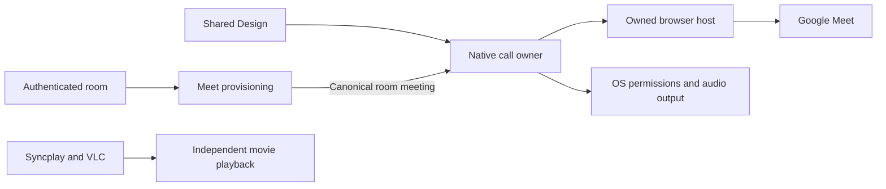

# Google Meet integration

## Required calling experience

Google Meet is the call provider. SyncWatch must own the call component, its lifetime, and its local resources on macOS, Windows, and Linux. A separate SyncWatch call window is acceptable. Opening a meeting in the operating system's browser or an independently installed PWA does not meet this requirement.

The current implementation provisions room-associated meetings and requests the registered HTTPS handler. This is an implemented handoff boundary, not an owned call host. It does not establish joined media, local hangup, capture release, or independent call gain. The owned host remains unimplemented.

Accounts, room membership, meeting provisioning, synchronization, and local calling have separate owners. Keep the existing [Meet service](../meet-service.md) and [account and room architecture](accounts-and-rooms.md). Replacing the presentation host must not replace Google Meet or change Syncplay timing.

## Host candidates

No browser runtime is adopted yet. Qualify these candidates before selecting one:

| Candidate | Intended use | Unresolved gate |
| --- | --- | --- |
| Chromium Embedded Framework (CEF), Alloy style | Native child surface or owned call window; one first-party C/C++ host with thin Swift, C#, and Kotlin/JNI adapters | Google sign-in and organizer admission, sandbox packaging, output playback with independent gain, echo cancellation, behavior on all three platforms |
| Bundled full Chromium | Dedicated SyncWatch-managed executable, profile, and call window | Google sign-in, lifecycle/control boundary, process reuse prevention, independent gain, source/build cost |

CEF provides native window embedding. On macOS, supplying a parent `NSView` selects Alloy style. Its audio interface exposes PCM output; source capture changes the audio path and needs a qualified playback sink. These facilities establish an experiment, not Meet compatibility. [CEF overview](https://github.com/chromiumembedded/cef), [macOS embedding](https://github.com/chromiumembedded/cef/blob/8ea0c73b5dbed1389c8dafb911a98c41246bb8cb/include/internal/cef_types_mac.h), [audio interface](https://github.com/chromiumembedded/cef/blob/8ea0c73b5dbed1389c8dafb911a98c41246bb8cb/include/cef_audio_handler.h).

Bundling Chromium alone does not supply a native calling contract. Application mode and a private profile are starting points. They do not prove ownership of every popup, capture process, audio stream, or shutdown. Google lists supported browsers for Meet; it does not certify our custom Chromium or CEF build. [Chromium switches](https://chromium.googlesource.com/chromium/src/+/6449d9f9a6a906edff724b7b220199b3fde4615c/chrome/common/chrome_switches.h), [Meet requirements](https://support.google.com/meet/answer/7317473?hl=en).

## Google interfaces and authentication

| Interface | Supported responsibility |
| --- | --- |
| Meet REST | Create and manage spaces. It does not render or transport a participant's call. [Overview](https://developers.google.com/workspace/meet/api/guides/overview) |
| `spaces.endActiveConference` | End the active conference as an authorized organizer. It does not close a local host or permanently revoke the meeting URI. [Reference](https://developers.google.com/workspace/meet/api/reference/rest/v2/spaces/endActiveConference) |
| Meet Add-ons | Embed applications inside Meet. This is the reverse integration direction. [Overview](https://developers.google.com/workspace/meet/add-ons/guides/overview) |
| Meet Media API | Discontinued. New enrollment is closed; endpoints shut down January 15, 2027. Do not adopt it. [Developer overview](https://developers.google.com/workspace/meet) |
| Historical Embed SDK | Historical references do not establish current SDK access. The published start-developing guide returns 404. Do not design against an unavailable package. [Historical release notes](https://developers.google.com/workspace/meet/release-notes), [guide location](https://developers.google.com/meet/embed/guides/start-developing) |

SyncWatch OAuth authorization must use a permitted browser flow. Google prohibits developer-controlled embedded user agents for OAuth authorization. App identity and the Meet website's Google session remain separate. Never import cookies, insert API tokens into a page, spoof the user agent, or collect Google credentials. [OAuth policy](https://developers.google.com/identity/protocols/oauth2/policies).

Google may also block ordinary account sign-in from embedded browsers. Test real organizer sign-in separately from anonymous guest admission. A successful guest join cannot establish account support. If neither host passes this gate, report the incompatibility before changing the required experience. [Google account browser guidance](https://support.google.com/accounts/answer/7675428?hl=en).

## Ownership and trust boundaries

The native call owner binds work to account, room epoch, call generation, and a local operation identifier. It owns cancellation, the call window, the isolated profile lease, and shutdown receipts. The browser host owns renderer processes and media resources. The shared Design library owns SyncWatch chrome, layout, copy, and actions. Google owns the meeting page and provider controls.

Validate the current room's canonical HTTPS `meet.google.com` URI before opening. Reject userinfo, nondefault ports, query/fragment data, malformed codes, foreign hosts, arbitrary schemes, and stale scopes. Never log meeting URIs, profile contents, cookies, or credentials. Pass structured local commands over private IPC; never execute server-supplied command lines.

Do not expose room credentials, local files, or a general native bridge to website content. Keep the renderer sandbox and normal certificate checks enabled. Scope camera and microphone decisions to the requesting origin and explicit user action. Deny unexpected origins, unsupported permissions, downloads, and native-protocol launches. Validate authentication navigation separately; a Meet-only hostname rule must not silently break legitimate Google account selection.

Use a SyncWatch-owned profile, separate from the user's browsers. Define profile persistence and deletion before enabling remembered web sign-in. Treat cookies as sensitive credentials. Use platform-protected storage where required; do not create a plaintext fallback or copy existing browser profiles.

## Lifecycle and truthful state

1. Join an authorized SyncWatch room without starting capture or remote audio.
2. Request or reuse its meeting through the authorized backend.
3. Open one owned call window after the user's explicit action.
4. Confirm the account, devices, permissions, and participation through reliable provider controls.
5. Keep movie playback usable during call failure or local hangup.
6. On leave, logout, revocation, or application exit, stop local call media and close every owned host resource.

Minimizing the call window preserves an active call. Closing it requests local teardown. Organizer **End call for everyone** remains a separate confirmed REST operation. Local shutdown does not prove remote conference termination.

Opening a window is not joining a call. Track host lifetime separately from observed participant/media state. Advertise capabilities only when the selected host implements and observes them. Never infer joined state from REST success, navigation, a display name, an audio callback, or an accepted OS launch.

Invalidate pending work on room/call replacement, leave, logout, and close. Late completions cannot reopen an obsolete call. Single-flight opening prevents duplicate windows. Shutdown must close all owned browsers, await their completion, release capture/audio, reap child processes, and release the profile lease. Use bounded escalation only for this host's verified process tree. Report incomplete shutdown instead of claiming success. CEF requires browser close callbacks before framework shutdown. [CEF lifecycle](https://github.com/chromiumembedded/cef/blob/8ea0c73b5dbed1389c8dafb911a98c41246bb8cb/include/cef_life_span_handler.h).

Independent received-call gain must affect only this device's call output. Movie volume, microphone gain, peers, and other applications stay unchanged. A native label or website volume patch is insufficient. Measure zero, intermediate, and full output, latency, and speaker/headphone echo behavior. Remote-speaking ducking remains a later capability unless reliably observable.

## Source, cost, and delivery gates

Before adding a runtime, pin its complete enabled external source graph as Git submodules under `3rdparty/`. Reuse existing dependency manifests, artifact identities, inventories, and license checks. Record exact revisions, build flags, source correspondence, helper packaging, sandbox requirements, and update ownership. CEF/Chromium root licenses alone do not cover their dependencies. Do not treat downloaded binaries or CIPD packages as source submodules.

Use free SDKs and standard Meet API quotas with billing disabled. Free personal group meetings have provider limits, including the meeting duration. Do not start a trial, enable paid fallback, or claim unlimited meetings. [Cost policy](cost-policy.md), [Meet API quotas](https://developers.google.com/workspace/meet/api/guides/limits), [Meet requirements](https://support.google.com/meet/answer/7317473?hl=en).

Qualify the smallest real organizer-and-guest experiment on all three desktops before building the full call UI. Measure memory and disk use; run one heavy job per physical host. Close each experiment's processes and profiles before the next run.

Then qualify the complete room-to-call journey: Library/Player entry, wrong account, permission denial/retry, unavailable devices, duplicate clicks, stale meetings, network loss, host crash, leave/logout/close during opening, minimize, reopen, and packaged restart. Test real bidirectional media in all six desktop directions alongside shared playback and independent local volumes. Source checks and navigation are preparation only. Required CI and normal upstream merge remain mandatory.
